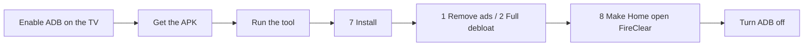

<div align="center">

# FireClear

**An ad-free, tvOS-style home screen and a one-menu cleaner for Fire TV Stick**

[](https://github.com/SH4d0w97/fireclear/actions/workflows/build.yml)


[**Download**](../../releases/latest) · [Install guide](docs/GUIDE.md) · [Remove ads](docs/ADS.md) · [Build it yourself](docs/BUILD.md) · [Security](docs/SECURITY.md)

</div>

> Replace `SH4d0w97` in the badge links above with your GitHub username after you publish.

## Why FireClear

Amazon's Fire TV home screen is full of banners, autoplay video and recommendations, and the stick runs background services you never asked for.
FireClear replaces the home screen with a calm, fast one, and ships a small tool that switches off the junk and blocks ads, with an **undo for everything**.

| | |
|---|---|
| **Home screen** | Favorites, Recent, all Apps and a Settings row, with a wallpaper behind |
| **tvOS feel** | Focused tile lifts, scales and casts a shadow; rows glide and centre; optional animations-off switch |
| **Everything reachable** | Every app, plus Wi-Fi, Bluetooth, Display, Sound, Apps, Storage, Date & Time, Language, Keyboard, Accessibility, Privacy, Developer, About, and **All Settings** |
| **Ad removal** | Four layers: no ads on the home screen, ad and tracking packages switched off, ad-blocking DNS, privacy toggles ([details](docs/ADS.md)) |
| **Light** | No libraries, no network, no background services; art is drawn once and cached (12 MB cap) |
| **Safe** | No internet permission, two harmless permissions, audited in CI ([details](docs/SECURITY.md)) |
| **Reversible** | Every change can be undone from the same menu |
| **Tablet friendly** | Do everything from an Android tablet with Termux, no PC needed |

```
 9:41                                      [ Wi-Fi ] [ Customize ] [ Settings ]
 Sunday, 25 October

 FAVORITES
 [ YouTube ]  [[ Prime Video ]]  [ Plex ]  [ Music ]        <- focused tile lifts
                 Prime Video
 RECENT
 [ Kodi ] [ Downloader ] [ Photos ] [ Browser ] [ Games ]
 APPS
 [ Appstore ] [ Calendar ] [ Files ] [ Weather ] ...
 SETTINGS
 [ All Settings ] [ Wi-Fi ] [ Bluetooth ] [ Display ] [ Sound ] ...
```

## Latest build: v2.3

| | |
|---|---|
| Version | **2.3** (versionCode 5), see [CHANGELOG](CHANGELOG.md) |
| Package | `app.fireclear.launcher` |
| Target device | Fire TV Stick 3rd gen, Fire OS 7 (Android 9). Other Fire OS devices: untested, reports welcome |
| Android levels | minSdk 25, targetSdk 28 |
| Permissions | `ACCESS_NETWORK_STATE`, `ACCESS_WIFI_STATE` only. **No internet.** |
| Dependencies | 0 |
| Assets | [Releases](../../releases/latest): `FireClear-vX.Y.apk` + `SHA256SUMS.txt` |

**What's new in 2.3:** tool menu gains **Remove ads only**, **Ad-blocking DNS on/off** (with automatic rollback if the internet breaks), a safer package-list split, and a rewritten set of docs.
Earlier: 2.2 tvOS-style UI and Settings row, 2.1 security hardening and CI.

## Quick start



1. **TV:** Settings > My Fire TV > About, press Select on the device name 7 times. Then Developer Options: **ADB debugging ON**, **Apps from Unknown Sources ON**. Note the IP under About > Network.
2. **APK:** download from [Releases](../../releases/latest), or build it free with GitHub ([docs/BUILD.md](docs/BUILD.md)).
3. **Computer or tablet:** install `adb` (Windows: platform-tools; macOS: `brew install android-platform-tools`; Linux: `sudo apt install adb`; Android tablet: Termux, see the [guide](docs/GUIDE.md#1-prepare-your-computer-or-tablet)).
4. Run the tool and follow the menu:
   ```bash
   cd tools
   bash firetv-tool.sh        # Windows: double-click firetv-tool.bat
   ```
   Recommended order: **7** install, **1** remove ads (or **2** full debloat), **4** ad-blocking DNS, **8** make Home open FireClear, reboot.
5. Turn **ADB debugging** and **Unknown Sources** back **off**.

Full walkthrough with every command: **[docs/GUIDE.md](docs/GUIDE.md)**.

## The tool menu

| # | Option | What it does |
|---|---|---|
| 1 | Remove ads only | Switches off ad, recommendation and tracking packages ([`packages-ads.txt`](tools/packages-ads.txt)). The safest option |
| 2 | Full debloat | Everything in [`packages.txt`](tools/packages.txt) (ads, telemetry, junk). Disable only |
| 3 | Full debloat, harder | Same, and removes for your user whatever Fire OS refuses to disable |
| 4 / 5 | Ad-blocking DNS on / off | Sets system Private DNS (default AdGuard). Tests the internet and **reverts itself** if it breaks |
| 6 | Undo debloat | Brings back every listed package |
| 7 | Install APK | `adb install -r` |
| 8 / 9 | Home to FireClear / back to Amazon | Disables or re-enables Amazon's home |
| 0 | Quit | Disconnects ADB |

## Remove the ads: four layers

1. **FireClear itself:** the Amazon home, where most Fire TV ads live, is out of the picture (menu 8).
2. **Package switch-off:** ad ID, recommendation, telemetry and shopping services (menu 1 or 2).
3. **Ad-blocking DNS:** blocks known ad and tracker domains for every app on the stick (menu 4).
4. **Privacy toggles** you set once by hand: [docs/ADS.md](docs/ADS.md#layer-4--privacy-toggles).

**Honest limits:** ads that apps serve from their own servers (for example inside YouTube or Prime Video) are mostly **not** removable this way.
DNS blocking helps with many third-party ad networks, not with ads delivered by the same servers as the video.

## Security at a glance

- No `INTERNET` permission: Android blocks all network traffic from the app. Nothing can be uploaded.
- Zero third-party libraries, no native code, no WebView, no reflection or dynamic code loading.
- One exported screen; it ignores intent extras.
- CI fails the build if any of this changes: [`scripts/audit.sh`](scripts/audit.sh), built-APK permission check, Android lint, CodeQL.
- The tool runs only `adb` against the IP you type, and validates every package name and hostname before it reaches the device.

Read the full threat model and limits in [docs/SECURITY.md](docs/SECURITY.md). Verify it yourself in 30 seconds: `bash scripts/audit.sh`.

## FAQ

<details><summary>Is it safe to disable Amazon packages?</summary>
It is unsupported by Amazon but reversible: menu 6 restores everything, and a factory reset is the last resort. Start with menu 1 and test the stick before going further.
</details>

<details><summary>Will it break Netflix, YouTube or Prime Video?</summary>
No app is touched. The lists contain only Amazon services. If casting from a phone stops working, re-enable <code>com.amazon.whisperplay.contracts</code> ([docs/DEBLOAT.md](docs/DEBLOAT.md)).
</details>

<details><summary>Menu 8 (Home) was refused, what now?</summary>
Use a Home-button remapper app and map Home to FireClear. See [docs/GUIDE.md](docs/GUIDE.md#troubleshooting).
</details>

<details><summary>Black screen after changing Home?</summary>
From any computer or Termux on the same Wi-Fi: <code>adb connect IP:5555</code> then <code>adb shell pm enable --user 0 com.amazon.tv.launcher</code>.
</details>

<details><summary>No internet after turning DNS on?</summary>
The tool reverts automatically. By hand: <code>adb shell settings put global private_dns_mode off</code>. One user reported a Fire TV 4K Max losing connectivity with this method, so it is opt-in.
</details>

<details><summary>Amazon updated my stick and the ads are back.</summary>
Updates can re-enable packages and the stock home. Run menu 1 or 2 and menu 8 again.
</details>

## Repository layout

```
app/                 the launcher (Kotlin, no dependencies)
tools/               firetv-tool.sh / .bat, package lists
scripts/             audit.sh, verify-apk.sh (also run in CI)
docs/                GUIDE, ADS, BUILD, DEBLOAT, SECURITY
.github/workflows/   build, release, CodeQL
```

## Contributing, license, disclaimer

PRs welcome, see [CONTRIBUTING.md](CONTRIBUTING.md). Please add device reports (model, Fire OS version, what worked) as issues.
Licensed under [MIT](LICENSE).
Not affiliated with Amazon or Apple. "tvOS-style" describes layout only; no Apple assets are used. Disabling system packages is at your own risk.
